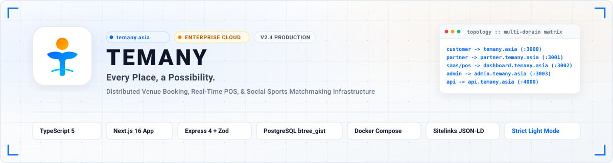
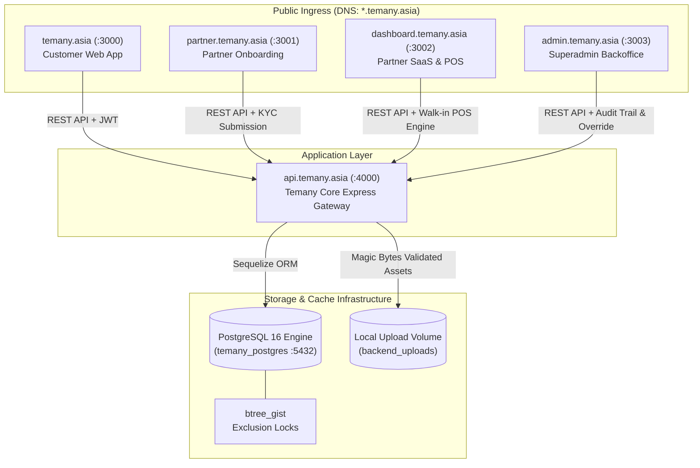

<div align="center">



# Temany Enterprise Platform Engineering

Distributed Sports Venue Booking, Point of Sale SaaS, and Social Matchmaking Infrastructure

[](https://temany.asia)
[](https://temany.asia)
[](https://temany.asia)
[-336791?style=flat-square)](https://www.postgresql.org)
[](#)

</div>

---

## 1. Executive Architecture Overview

Temany is a distributed enterprise booking and venue management ecosystem designed for the Indonesian sports, creative studio, and event venue marketplace. The platform connects consumers, venue partners, and operations personnel through five specialized service frontends orchestrated around a centralized RESTful API gateway.

The platform eliminates booking conflicts through hardware-level PostgreSQL exclusion constraints, provides instantaneous QRIS payment settlement with automated split-bill distribution, and delivers SEO discoverability modeled after Booking.com sitelinks architecture.

---

## 2. Multi-Domain Routing Topology

The platform operates across dedicated subdomain hostnames routed via reverse proxy in production and bound to distinct local ports during development:

| Service Subdomain | Port | Component | Application Type | Primary Audience |
| :--- | :---: | :--- | :--- | :--- |
| `temany.asia` | `3000` | Customer Web App (`client`) | Next.js 16 (App Router) | General Public, Athletes, Event Organizers |
| `partner.temany.asia` | `3001` | Partner Onboarding Portal (`partner`) | Next.js 16 (App Router) | Prospective Venue Owners, Business Registrants |
| `dashboard.temany.asia` | `3002` | Partner SaaS &amp; Walk-in POS (`dashboard`) | Next.js 16 (App Router) | Active Venue Managers, Front Desk Cashiers |
| `admin.temany.asia` | `3003` | Superadmin Backoffice Console (`admin`) | Next.js 16 (App Router) | Temany Platform Operations &amp; Compliance |
| `api.temany.asia` | `4000` | Core API Gateway &amp; Engine (`backend`) | Node.js 20 / Express / Sequelize | Internal Services, Webhooks, Mobile Clients |

---

## 3. Official Organization Repositories

The Temany codebase is organized into seven modular GitHub repositories:

| Repository | Scope and Responsibility | Primary Stack | CI Status |
| :--- | :--- | :--- | :--- |
| [temany/.github](https://github.com/temany/.github) | Organization-wide standards, profile documentation, and shared CI templates | Markdown, GitHub Actions | Maintained |
| [temany/backend](https://github.com/temany/backend) | Core REST API, 31 database migrations, seeders, and unit/integration/pentest suites | Node.js 20, TypeScript, Express, Sequelize, PostgreSQL 16 | Tested (153 Tests) |
| [temany/client](https://github.com/temany/client) | Customer portal, dedicated SSR category slugs (`/c/[slug]`), and Booking.com JSON-LD | Next.js 16, React 19, TypeScript, Tailwind CSS | Active |
| [temany/partner](https://github.com/temany/partner) | 3-step KYC business onboarding wizard and dynamic revenue estimation model | Next.js 16, React 19, TypeScript, Tailwind CSS | Active |
| [temany/dashboard](https://github.com/temany/dashboard) | Venue management, dynamic pricing schedules, and real-time walk-in POS terminal | Next.js 16, React 19, TypeScript, Tailwind CSS | Active |
| [temany/admin](https://github.com/temany/admin) | Partner KYC approval, venue overrides, dispute simulation, and audit inspection | Next.js 16, React 19, TypeScript, Tailwind CSS | Active |
| [temany/scripts](https://github.com/temany/scripts) | Orchestration shell scripts (`start.sh`, `restart.sh`, `log.sh`) and master Compose | Bash, Docker Compose, Python | Verified |

---

## 4. End-to-End System Architecture



---

## 5. Architectural Guarantees and Design Standards

### A. Mathematical Anti-Double Booking Concurrency
To guarantee zero double-bookings under high concurrency without relying solely on distributed cache locks, Temany enforces a PostgreSQL hardware-level exclusion constraint (`EXCLUDE USING gist`) combined with transactional `SERIALIZABLE` isolation:

```sql
ALTER TABLE venue_bookings 
ADD CONSTRAINT no_overlapping_confirmed_bookings 
EXCLUDE USING gist (
  unit_id WITH =,
  booking_date WITH =,
  tsrange(start_time, end_time) WITH &&
) 
WHERE (status IN ('CONFIRMED', 'PENDING_PAYMENT'));
```

When five concurrent booking requests hit the exact same court slot simultaneously, exactly one transaction commits (`HTTP 201 Created`) while the remaining four fail safely (`HTTP 409 Conflict`).

### B. Booking.com-Grade Google Sitelinks SEO
All public pages publish structured data schemas conforming to Schema.org standards:
- `WebSite` with `SearchAction` enabling sitelinks search boxes directly on Google search results pages.
- `SiteNavigationElement` declaring top-level sitelinks for categories, community matchmaking, split-bill, and authentication.
- `CollectionPage` + `ItemList` on dedicated category landing pages (`/c/[slug]`) exposing structured venue rates and ratings.
- Automated `308 Permanent Redirect` middleware converting historical `/?category=[slug]` queries to clean SSR slug routes.
- Strict `robots: { index: false, follow: false }` metadata on private portals (`dashboard.temany.asia` and `admin.temany.asia`) to prevent SaaS screens from polluting public search results.

### C. Strict Light Mode Aesthetics
The user interface follows a clean, high-contrast, strictly light-mode visual design language:
- Primary Canvas: `#FFFFFF`
- Surface Secondary: `#F8FAFC`
- Electric Blue Accent: `#0066FF`
- Sky Cyan Accent: `#00C2FF`
- Sun Amber Accent: `#FF7A00`
- Slate Typography: `#0F172A` (Primary), `#475569` (Secondary), `#94A3B8` (Muted)
- Vector Icons Only: Lucide React with standard 1.75px stroke width; exactly zero Unicode emojis across all services.

### D. Multi-Domain CORS and Security Isolation
- In production, cross-origin resource sharing (`CORS`) is locked to subdomains matching `*.temany.asia`.
- Multi-part file uploads are protected with file signature (Magic Bytes) inspection to reject disguised executable payloads, Web shells, or embedded SVG script injections before persisting to disk.
- Role-Based Access Control (`RBAC`) strictly separates `USER`, `PARTNER`, and `SUPERADMIN` authorization boundaries, audited continuously via automated penetration test suites.

---

## 6. Local Development and Deployment

The complete 5-service ecosystem and database containers can be initialized with a single command via the orchestration repository:

```bash
# Clone the orchestration scripts repository
git clone https://github.com/temany/scripts.git
cd scripts

# Start all database engines and 5 application services
./start.sh

# Tail aggregated container logs
./log.sh

# Verify health across all 5 endpoints
./verify-all.sh
```

---

## 7. Security and Vulnerability Disclosure

If you discover a security vulnerability within any Temany repository, please email security@temany.asia. All reports are evaluated by platform engineering within 24 hours.
